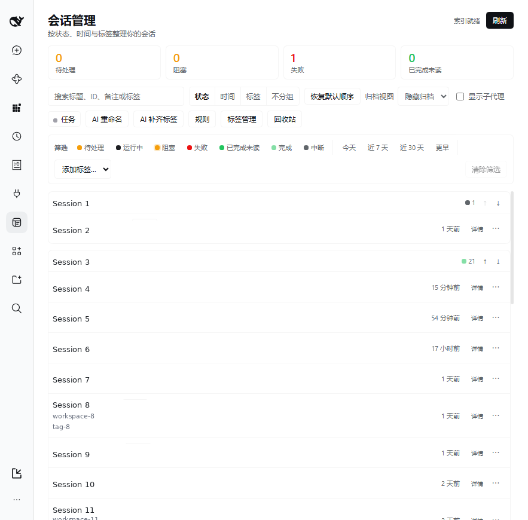
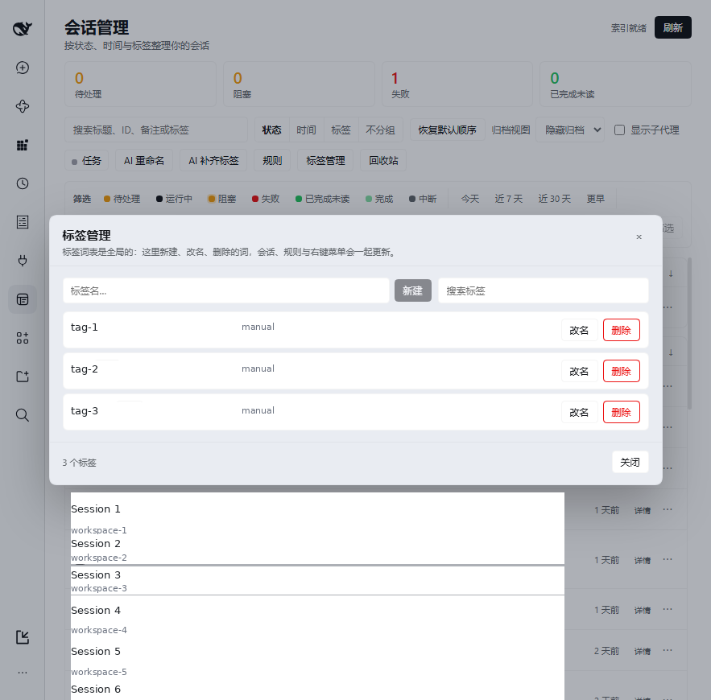
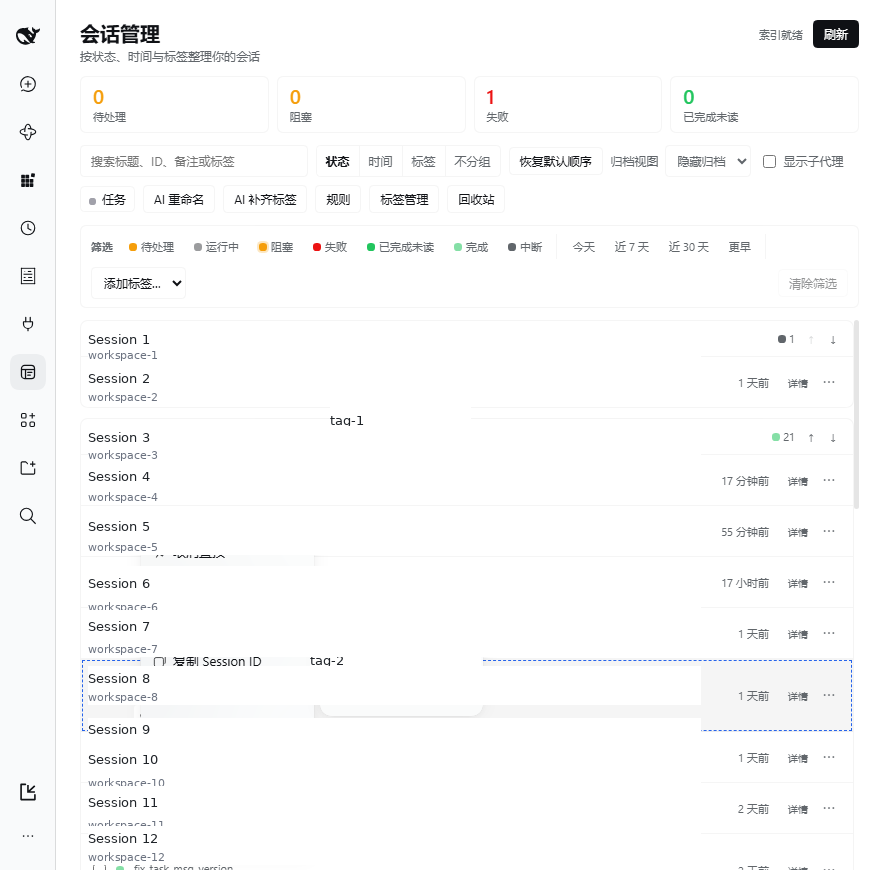
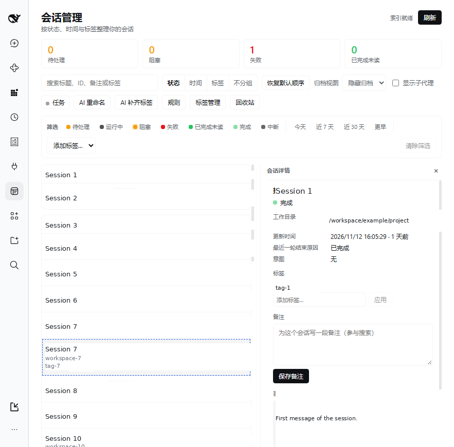
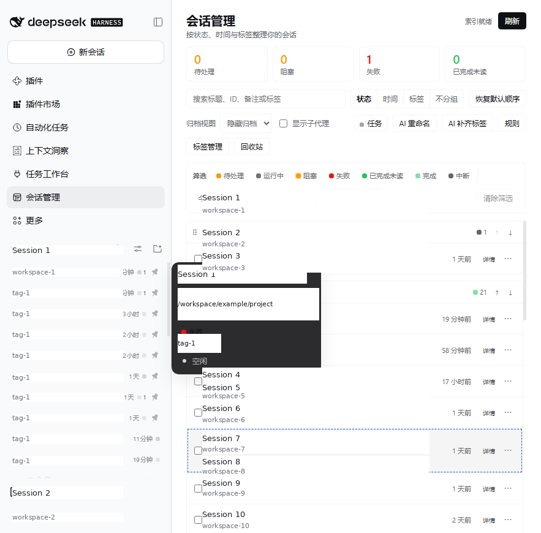

# dsh-session-manager

[中文说明](./README.zh.md) · **English**

A session manager panel for the DSH Web GUI: browse your sessions grouped by **status (7 states) / time bucket / tag**, with tag rules, AI batch rename and AI auto-tagging (always preview-then-apply, slow work runs as background jobs), archive and trash. Row-level actions reuse the native sidebar's own context menu and row seats instead of inventing a parallel UI.

[](./package.json)
[](./tests)
[](./package.json)



## Why

The native sidebar is one column of sessions ordered by working directory. It cannot tell you *who is waiting on me*, *what died*, or *which of these belong to the same project*. This plugin gives you a grouped, filterable asset view of the same sessions.

And when a batch of sessions needs renaming or tagging, clicking through them one by one is not realistic. Here you select them, let the model produce a list, confirm it, and write it back in one pass.

## Features

- **Grouping** — by status / time bucket / tag / none. Group headers always show the total and all seven status counts, collapsed or not.
- **Your own group order** — drag the ⠿ handle, or nudge with ↑/↓. The order is remembered per dimension in the browser, with a "reset order" button.
- **Overview strip** — four clickable counters (pending / blocked / failed / completed-unread); one click is one filter.
- **Filter and search** — status, time bucket and tag stack together; search matches title, session ID prefix, note and tags.
- **Tagging** — batch append / replace / clear, rule-driven suggestions, AI suggestions with intent, and one-click "fill missing tags" that never overwrites.
- **Tag manager** — a real CRUD surface for the vocabulary: create, rename (renaming onto an existing word merges them), delete (clears the word from every session and rule), search, and usage counts.
- **AI batch rename** — preview first (old → new, the evidence, skip reasons, per-item cancel), then apply as a background job.
- **Native integration** — right-click a row and you get the *native* shared menu, with a 「标签」 submenu and 「查看详情」/「打开会话」 appended. The native sidebar rows also show a status dot and tag count, plus status and tags in the hover card.
- **Session actions** — jump to session, fork, pin, copy ID, reveal in folder, archive/restore, trash.
- **Background jobs** — progress, cancel, per-item detail; a host restart marks unfinished jobs as interrupted instead of silently rerunning them.

## Screenshots

| Tag manager | Native context menu + tag submenu |
|---|---|
|  |  |

| In-panel detail split | Native sidebar decorations |
|---|---|
|  |  |

## Install

```bash
# Into the current profile (web):
dsh plugin --profile web add "https://github.com/blindcat-10835/dsh-session-manager"
```

Or from a local checkout, which is what development uses:

```bash
cd /root/.dsh/profiles/web
pnpm add link:/path/to/dsh-session-manager
# then add the package name to dsh.profile.bundles in package.json:
#   "dsh-session-manager"
```

> Use `link:` rather than `file:`: the profile's `node_modules` then points at your working copy, so edits to `client.js` / `host/*` take effect on restart. `file:` copies the package and your edits stop mattering.

Installing appends this package to the profile's bundle stack and merges the `insert` row from [cordis.patch.yml](./cordis.patch.yml), so no manual cordis edit is needed. After a restart (`dsh --profile web`, or `restart-web.sh` outside the repo) a 「会话管理」 entry appears in the sidebar. The first open indexes historical sessions in the background (about 30 seconds for ~185 sessions); titles and the failed/blocked states fill in as it goes.

## Usage

1. **Grouping** — switch between status / time bucket / tag / none in the toolbar. Group headers always show the group's total and the pending/running/blocked/failed/completed-unread counts, even collapsed.
2. **Your own group order** — drag a group's ⠿ handle to move it, or use the ↑/↓ buttons on the header. The order is remembered per dimension (status / time / tag) and survives a reload; "reset order" in the toolbar restores the natural order.
3. **Overview** — the four counters at the top (pending / blocked / failed / completed-unread); clicking one filters by it.
4. **Filter and search** — status, time bucket and tag stack; the search box matches title, session ID prefix, note and tags. Switch the archive view to "archived only" to search archived sessions.
5. **Tagging** — select sessions, then append / replace / clear from the batch bar. Single rows can be edited from the row menu. Tags come from manual edits, rules, or AI. Whichever entry point you use, the panel refreshes its chips within about a second.
6. **Tag manager** — the toolbar's 「标签管理」 lists every tag with its source (manual / rule / AI), usage (how many sessions, how many suggestions) and creation time, and is searchable. Create, rename (a name collision merges the two), or delete (which clears the word from sessions and rules, leaving the sessions themselves alone; a two-step confirm spells out the impact).
7. **Tag rules** — the rule editor takes conditions (title / first message / working directory / note + keywords) and an action (suggest only, or add directly). The hit preview writes nothing; rules never delete an existing tag.
8. **AI batch rename** — select → 「AI 批量重命名」 → preview (old title → new title plus the evidence; running / blank / subagent / locked sessions are skipped with a stated reason) → cancel individual items → apply.
9. **AI tagging / intent** — the same preview offers suggested tags and an intent classification (development / debugging / research / docs / ops / other); nothing is written until you accept it.
10. **Archive / trash** — archiving moves a session out of the current list (restorable); deleting moves the session directory into the plugin's trash (restorable, see below).
11. **Fill missing tags** — writes existing suggested tags only to sessions that have no tags at all, and never overwrites.
12. **Context menu (the native one)** — right-clicking a row opens the **native shared menu**: pin/unpin, rename, fork, copy Session ID, reveal in folder, archive/unarchive all work as they do natively. The plugin appends a 「标签」 submenu (click to toggle a tag, written immediately with native feedback) and, while the panel is on screen, 「查看详情」 and 「打开会话」. The native menu can only be appended to, never edited.
13. **Jump to session** — double-click a row, use 「打开会话」, or press `Ctrl+Enter`; equivalent to clicking the session in the native sidebar.
14. **Row "⋯" menu** — the plugin-only actions (edit tags, edit note, move to trash) live behind the ⋯ at the end of the row, since the native menu cannot host the plugin's own dialogs.
15. **Detail split** — the row's 「详情」 button, 「查看详情」, or `Enter` on a selected row opens a detail column inside the panel: status, working directory, tags (editable in place), intent, note (editable in place), first message, last turn's end reason, and the Session ID; open / fork / archive / delete from there.
16. **Background jobs** — AI rename preview, AI tag preview, applying a rename and filling missing tags all create a **job**; the toolbar indicator shows progress and offers cancel, and results and failure reasons survive leaving the panel.
17. **Shortcuts** — with the panel focused and a row selected: `Ctrl+Alt+G` rename, `Ctrl+Shift+F` fork, `Ctrl+Alt+A` archive. Inside a menu, `↑`/`↓`/`Enter`/`Esc` work.
18. **Native sidebar decorations** — sessions with tags or a notable status show a status dot and tag count at the end of the native row, and the hover card shows the status name and tag chips, so you can tell what is going on without opening anything. The native grouping and ordering are untouched.

## Capability boundaries (measured, v1.0)

| What you might want | Possible? | Why |
|---|---|---|
| Panel row right-click = native menu | ✅ | `ctx.contextMenus.open({kind:'session', …})` — the same popup the native row uses |
| Add a 「标签」 submenu to the native menu | ✅ | `contextMenus.register({target:'session'})` plus a `children` submenu |
| Decorate native sidebar rows / hover card | ✅ | The `sidebar.session.row.trailing` and `sidebar.session.row.hover` seats |
| Add "by status / by tag" to the native grouping menu | ❌ | Those three entries are a hardcoded array in `ui-workspace` with no slot (PRD D13) |
| Hide or reorder native menu items | ❌ | Append-only (PRD D14) |
| Create a tag from the right-click submenu | ❌ | Menu entries are plain buttons; creation lives in the panel's tag manager (PRD D15) |
| Drag groups into your own order | ✅ | v0.3.1: ⠿ drag plus ↑/↓, remembered per dimension in `localStorage` (PRD §7.6 / ADR-0008) |
| Drag an individual session within a group | ❌ | Rows stay newest-first; ordering applies between groups only (PRD §7.6) |
| Create / rename / delete tags | ✅ | v0.3.2: the 「标签管理」 dialog; a rename collision merges, a delete clears references (PRD §7.7 / ADR-0009) |
| Right-click a tag and see it in the panel immediately | ✅ | v0.3.2: a tag-write broadcast wakes the panel within its 1.5s merge window (PRD D16) |
| Tag colours / hierarchy / aliases | ❌ | The vocabulary is name, source and creation time only (M2) |

## Configuration

Configuration lives in the profile's plugin config (the `config` section of `cordis.patch.yml`), and can be overridden by the bundle defaults at install time:

```yaml
- insert:
    - id: session-manager
      name: 'dsh-session-manager'
      config:
        dataDir: /custom/path             # defaults to $DSH_HOME/storages/session-manager
        status:
          enabled: true
          tailEvents: 120                 # how many tail events decide blocked/failed
          concurrency: 2
        ai:
          batchSize: 8                    # sessions per model call
          concurrency: 2
          maxSessionsPerRun: 50
          readContent: true               # feed the first message to the model
          titleMaxChars: 48
```

All data lands in `dataDir`:

| File | Contents |
|---|---|
| `state.json` | Tags, suggested tags, notes, title locks, intents, the tag vocabulary, rules, settings |
| `status-index.json` | Per-session log-tail facts (last turn end, title, first message) |
| `trash.json` | Trash index |
| `jobs.json` | Background jobs (unfinished ones plus the most recent 50 finished) |
| `trash/<sessionId>/` | The moved session directory |

## Where the AI comes from

The plugin does not introduce a second set of credentials: it reuses the host's configured `llm` and `agentDefaultModel` route. With no usable route the AI buttons grey out and state why (HTTP 503 `llm_unavailable`), while tag rules and manual actions keep working.

## HTTP API

The browser half cannot use typed RPC, so client and host talk over same-origin HTTP under `/api/dsh-session-manager`. The full contract is in [docs/PRD.md](./docs/PRD.md) §8; the common ones:

```bash
curl -s localhost:3081/api/dsh-session-manager/state | jq .
curl -s 'localhost:3081/api/dsh-session-manager/sessions?includeArchived=1' | jq '.rows[0]'
curl -s -X POST localhost:3081/api/dsh-session-manager/tags -H 'content-type: application/json' \
  -d '{"sessionIds":["<id>"],"op":"append","tags":["bug"]}'

# The tag vocabulary
curl -s localhost:3081/api/dsh-session-manager/tag-defs | jq '.tagDefs[] | {name,sessions}'
curl -s -X POST localhost:3081/api/dsh-session-manager/tag-defs -H 'content-type: application/json' \
  -d '{"op":"rename","name":"bug","to":"defect"}'

# Slow operations return 202 plus a job object; poll it afterwards
curl -s -X POST localhost:3081/api/dsh-session-manager/tags/fill-missing \
  -H 'content-type: application/json' -d '{"dryRun":true}' | jq '.job | {id,type,state}'
curl -s 'localhost:3081/api/dsh-session-manager/jobs?active=1' | jq '.jobs[] | {id,type,state,percent}'
curl -s localhost:3081/api/dsh-session-manager/jobs/<jobId> | jq '.job | {state,result,items:[.items[]|{key,state,message}]}'
curl -s -X POST localhost:3081/api/dsh-session-manager/jobs/<jobId>/cancel | jq '.job.state'
```

## Known deviations and limits

- **Delete means trash**: DSH has no session-delete API, so deleting moves the session directory into the plugin's trash and can be restored; erasing for real means cleaning `trash/` by hand (PRD D1).
- **Subagent sessions are hidden by default** and never join a batch (D2).
- **Tag grouping can double-count**: a session with several tags appears in several groups (D3).
- **Failed / blocked / interrupted depend on the log-tail index**: the first load indexes historical sessions in the background (~185 sessions, ~237MB of compressed logs here). Until it finishes those sessions show as "completed" and refresh automatically afterwards (D6).
- **An AI-renamed title pins the native auto-title**: in the official title semantics a "user" source blocks automatic refresh; the plugin also stores its own `titleLocked`, and only a manual rename sets it (ADR-0004).
- **The right-click menu is the native one, appended to**: the plugin can add entries but cannot remove or reorder native ones, and it does not rewrite the native menu (D7/D14).
- **The detail view is an in-panel split, not the native right sidebar**: the native right sidebar only serves the session currently on screen, and with the plugin panel owning the main column there is no surface to mount into (measured: `sidebarRight: no session surface is mounted`), so the detail lives inside the panel (D8). The cost is that it cannot share the screen with the native right sidebar.
- **Jobs do not survive a host restart**: unfinished jobs are marked interrupted and are not rerun automatically; writes that already happened are not rolled back (D9).
- **The native sidebar itself is not rewritten** (D5); row-level capability lives in the plugin panel, plus the read-only decorations described above.

## Development

```bash
node --check index.js client.js host/*.js
node --test 'tests/*.test.js'   # plain node:test, no build step
```

Layout: `index.js` host assembly, `host/` server-side modules, `client.js` the single-file browser panel, `locale/` copy, `docs/` product and decision records, `tests/`. The internal module contract is in [docs/CONTRACTS.md](./docs/CONTRACTS.md).

## Documentation

- [docs/PRD.md](./docs/PRD.md) — product spec, user stories, HTTP contract, 16 recorded deviations
- [docs/PRD-AUDIT.md](./docs/PRD-AUDIT.md) — every user story mapped to its implementation and tests
- [docs/CONTRACTS.md](./docs/CONTRACTS.md) — internal module interfaces
- [docs/US.md](./docs/US.md) — the user stories as originally written
- [docs/adr/](./docs/adr/) — architecture decision records

## Decision records

- [ADR-0001 Main panel rather than rewriting the native sidebar](./docs/adr/0001-main-panel-not-native-sidebar.md)
- [ADR-0002 Single status vocabulary derived from the log tail](./docs/adr/0002-single-status-derived-from-log-tail.md)
- [ADR-0003 User data lives in the plugin's own state file](./docs/adr/0003-user-data-in-plugin-state-file.md)
- [ADR-0004 AI rename uses the user title source and its own lock](./docs/adr/0004-ai-rename-uses-user-title-and-own-lock.md)
- [ADR-0005 Slow batches run as host jobs](./docs/adr/0005-slow-batches-run-as-host-jobs.md)
- [ADR-0006 The detail split lives inside the panel](./docs/adr/0006-detail-split-inside-the-panel.md)
- [ADR-0007 Reuse the native context menu and decorate via row seats](./docs/adr/0007-reuse-native-context-menu-and-row-seats.md)
- [ADR-0008 Group order lives in the client](./docs/adr/0008-group-order-lives-in-the-client.md)
- [ADR-0009 Tag vocabulary CRUD in the host, merge on rename](./docs/adr/0009-tag-vocabulary-crud.md)

## License

MIT
