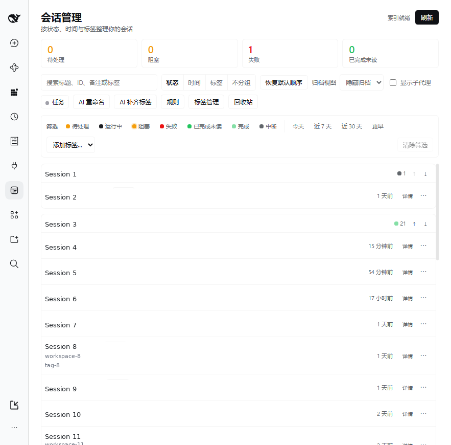
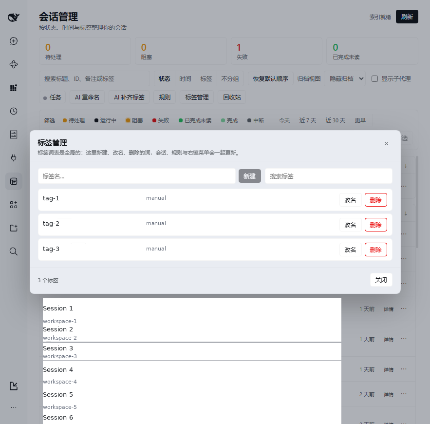
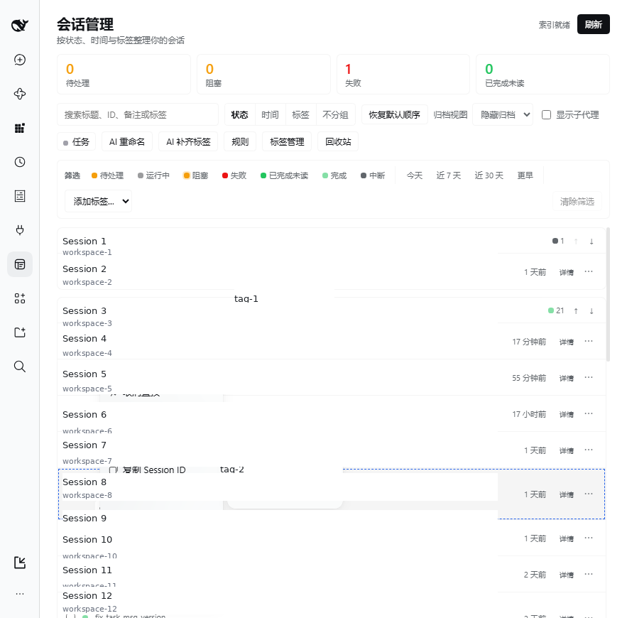
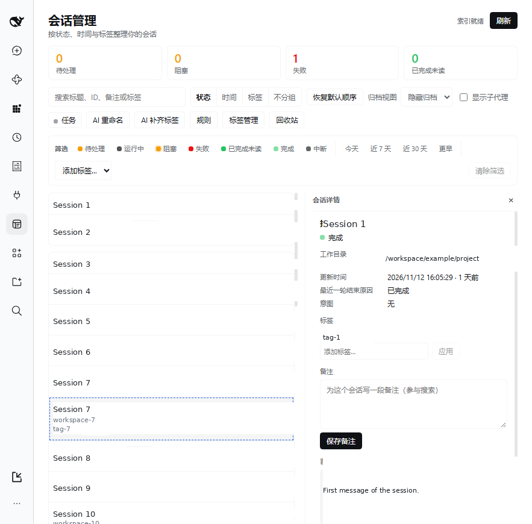
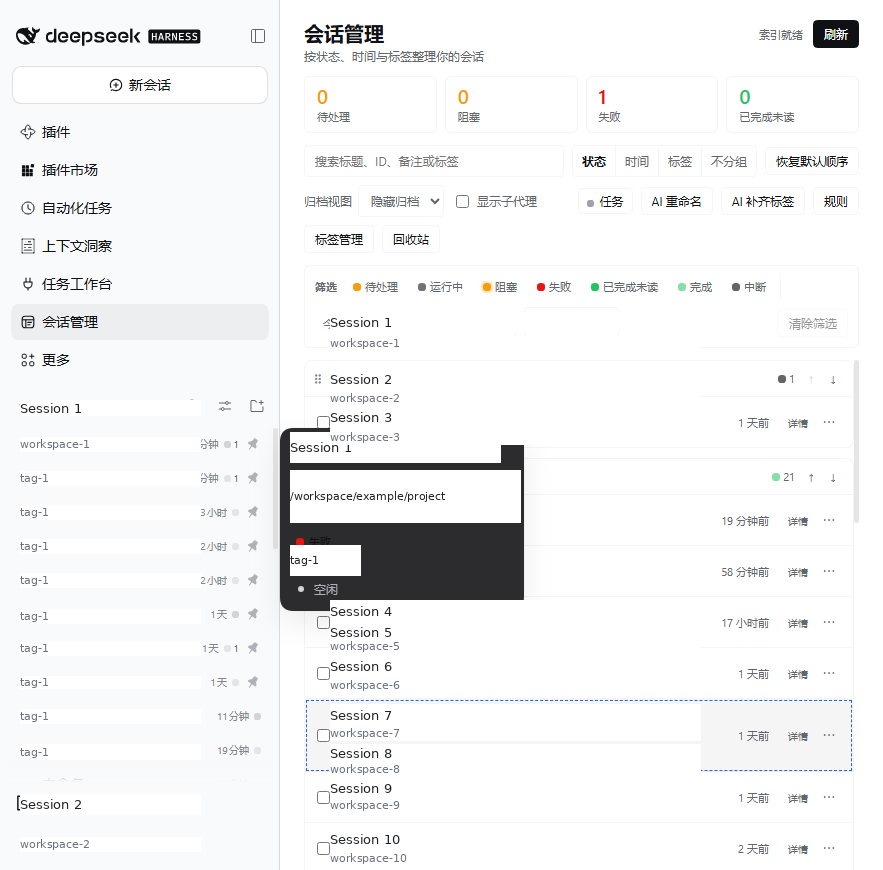

# dsh-session-studio

**中文** · [English](./README.md)

DSH Web 的会话管理面板：把会话按**状态（7 档：待处理/运行中/阻塞/失败/已完成未读/中断/完成）/ 时间桶 / 标签**分组浏览，支持标签规则、AI 批量重命名、AI 自动打标签（一律先预览-应用，慢操作以后台任务运行）、归档与回收站；行级操作复用原生左栏自己的右键菜单与行座位，不另起一套交互。

[](./package.json)
[](./tests)
[](./package.json)



## 它解决什么

原生左栏是一列按工作目录排的会话，看不出“谁在等我、谁挂了、哪些属于同一个项目”。本插件给出一张可分组、可筛选的资产视图。

一批会话需要统一改名或打标签时，靠手点不现实。这里可以勾选 → AI 产出一份清单 → 你确认 → 一次写回。

## 功能

- **一套图标词表**：状态 7 档、时间 4 桶、分组 4 维、标签、标签来源、规则模式、任务状态、空态，全部挂在同一张映射表上；组头、行、筛选、概览、详情、chip、规则、原生左栏徽标与悬停卡里同一个分类必然同图标。
- **分组**：状态 / 时间桶 / 标签 / 不分组。组头始终显示该组总数与全部 7 档状态计数，折叠也在。
- **分组顺序自己定**：拖组头的 ⠿ 柄，或用组头的 ↑/↓ 一格一格移；顺序按维度记在浏览器本地，工具栏「恢复默认顺序」一键还原。
- **概览条**：待处理 / 阻塞 / 失败 / 已完成未读 四个可点计数，点一下就是一个筛选。
- **筛选与搜索**：状态、时间桶、标签可叠加；搜索匹配标题、会话 ID 前缀、备注与标签。
- **打标签**：批量追加 / 替换 / 清空，规则命中建议，AI 建议与意图，一键补齐缺失标签（绝不覆盖已有）。
- **标签管理**：真正的词表 CRUD——新建、改名（撞名即合并）、删除（连带清掉会话与规则上的该词）、搜索、用量统计。
- **AI 批量重命名**：先出预览（旧→新、依据、跳过原因、逐条取消），确认后作为后台任务应用。
- **原生集成**：行上右键弹出**原生共享菜单**，插件追加「标签」子菜单与「查看详情」「打开会话」；原生左栏行尾显示状态图标与标签数，悬停卡显示状态与标签图标。
- **会话操作**：跳转、分叉、置顶、复制 ID、在文件夹显示、归档/恢复、回收站。
- **后台任务**：有进度、可取消、有逐条明细；宿主重启后未完成任务标记为「已中断」，不静默重跑。

## 界面截图

| 标签管理 | 原生右键菜单 + 标签子菜单 |
|---|---|
|  |  |

| 面板内详情分栏 | 原生左栏行装饰 |
|---|---|
|  |  |

## 安装

```bash
# 装进当前 profile（web）：
dsh plugin --profile web add "https://github.com/blindcat-10835/dsh-session-studio"
```

或者从本地工作区安装（开发时用的就是这条）：

```bash
cd /root/.dsh/profiles/web
pnpm add link:/path/to/dsh-session-studio
# 再把包名加到 package.json 的 dsh.profile.bundles 里：
#   "dsh-session-studio"
```

> 用 `link:`（而不是 `file:`）安装，profile 的 `node_modules` 是指向工作区的符号链接，改完 `client.js` / `host/*` 重启即生效；`file:` 会复制一份，改代码不生效。

> 1.1.0 起由 `dsh-session-manager` 改名，避免与同名插件冲突。原 `$DSH_HOME/storages/session-manager` 数据会在首次加载时搬到 `storages/session-studio`；环境变量 `DSH_SESSION_MANAGER_DIR` 仍然兼容。

安装会把本包加进当前 profile 的 bundle 栈，并合并 [cordis.patch.yml](./cordis.patch.yml) 里的 `insert` 行，不需要手工编辑 profile 的 cordis 配置。重启后（`dsh --profile web`，或仓库外的 `restart-web.sh`），侧栏出现「会话管理」入口。首次打开会在后台索引历史会话（本机 185 个约 30 秒），期间标题与失败/阻塞状态会逐步补齐。

## 使用

1. **分组**：工具栏切换 状态 / 时间桶 / 标签 / 不分组。组头始终显示该组数量和待处理/运行中/阻塞/失败/已完成未读的计数，折叠也在。
2. **分组顺序自己定**：拖组头的 ⠿ 柄把组挪到别处，或用组头的 ↑/↓ 一格一格移。顺序按维度（状态/时间/标签）分别记住，刷新也在；工具栏的「恢复默认顺序」一键回到自然顺序。
3. **概览**：顶部四个计数（待处理 / 阻塞 / 失败 / 已完成未读），点一下就是一个筛选。
4. **筛选与搜索**：状态、时间桶、标签可以叠加；搜索框按标题、会话 ID 前缀、备注、标签匹配。归档视图切到「只看归档」即可搜索归档会话。
5. **打标签**：勾选会话 → 批量条上「追加 / 替换 / 清空」。也可以在行菜单里编辑单条。标签来源分为手动、规则、AI。任何入口打完标签，面板都会在一秒多内自动刷新出 chip。
6. **标签管理**：工具栏「标签管理」列出所有标签——来源（手动/规则/AI）、用量（几个会话、几条建议）、创建时间，可搜索。在这里新建、改名（撞名即合并）、删除（连带清掉会话与规则上的该词，会话本身不动；删除前二次确认写清影响面）。
7. **标签规则**：规则编辑器里配条件（标题 / 首条消息 / 工作目录 / 备注 + 关键词）和动作（只建议 或 直接加）。命中预览零写入，确认后再应用；规则从不删除已有标签。
8. **AI 批量重命名**：勾选 → 「AI 批量重命名」→ 预览（旧标题 → 新标题 + 依据；运行中/空白/子代理/已锁定会被跳过并写明原因）→ 逐条取消 → 应用。
9. **AI 打标签 / 意图**：同一个预览里给出建议标签与意图分类（开发/排查/调研/文档/运维/其它），采纳后才写入。
10. **归档 / 回收站**：归档把会话移出当前列表（可恢复）；删除把会话目录移入插件回收站（可恢复，见下）。
11. **一键补齐标签**：只对“一个标签都没有”的会话写入已有建议标签，绝不覆盖。
12. **右键菜单（就是原生那个）**：行上右键弹出**原生共享菜单**——置顶/取消置顶、重命名、分叉会话、复制 Session ID、在文件夹显示、归档/取消归档全部原样可用；插件追加「标签」子菜单（点一下勾选/取消，立即写入并给原生提示），面板在场时再加「查看详情」「打开会话」。原生菜单只能追加、不能删改原生项。
13. **跳转到会话**：双击行、右键「打开会话」或选中后 `Ctrl+Enter`，与在原生左栏点击等价。
14. **行内「⋯」菜单**：插件专属的标签编辑、备注、移入回收站放在行尾的「⋯」里（右键给原生菜单，见上一条），三条都会打开对应的对话框。
15. **详情分栏**：行内「详情」/右键「查看详情」/选中行 `Enter` 在面板右侧分栏打开详情：状态、工作目录、标签（可就地增删）、意图、备注（可就地编辑）、首条消息、最近一轮结束原因、Session ID；并在面板内直接打开/分叉/归档/删除。
16. **后台任务**：AI 重命名预览、AI 标签预览、应用重命名、补齐缺失标签都创建**任务**，工具栏任务指示器显示进度，可取消；任务结果与失败原因保留，离开面板再回来仍在。
17. **快捷键**：面板有焦点且有选中行时，`Ctrl+Alt+G` 重命名、`Ctrl+Shift+F` 分叉、`Ctrl+Alt+A` 归档；菜单内 `↑`/`↓`/`Enter`/`Esc` 可操作。
18. **原生左栏的行装饰**：打了标签/有状态的会话，在原生左栏行尾显示状态点与标签数，悬停卡里显示状态名与标签 chip——不点开会话也能看出大概；不改原生分组与排序。

## 能力边界（实测，v1.0）

| 想做的 | 能不能 | 说明 |
|---|---|---|
| 面板行右键 = 原生菜单 | ✅ | `ctx.contextMenus.open({kind:'session', …})`，与原生行同一个弹层 |
| 给原生菜单加「标签」子菜单 | ✅ | `contextMenus.register({target:'session'})` + `children` 子菜单 |
| 原生左栏行尾/悬停卡加装饰 | ✅ | `sidebar.session.row.trailing` / `sidebar.session.row.hover` 两个座位 |
| 在原生「分组方式」里加「按状态/按标签」 | ❌ | 那三项是 `ui-workspace` 里的硬编码数组，没有插槽（PRD D13） |
| 隐藏/重排原生菜单项 | ❌ | 只能追加（PRD D14） |
| 右键子菜单里新建标签 | ❌ | 条目是纯按钮；新建仍在面板的标签管理器里（PRD D15） |
| 面板里把分组上下拖动排序 | ✅ | v0.3.1：⠿ 拖动 + ↑/↓，顺序按维度记在 `localStorage`（PRD §7.6 / ADR-0008） |
| 拖动单条会话在组内换位 | ❌ | 组内固定「最新在前」；排序只作用于组与组之间（PRD §7.6） |
| 标签的新建/改名/删除 | ✅ | v0.3.2：工具栏「标签管理」，改名撞名即合并，删除连带清会话与规则引用（PRD §7.7 / ADR-0009） |
| 右键打完标签，面板立刻更新 | ✅ | v0.3.2：标签写入广播桥，面板在 1.5s 合并窗口内刷新（PRD D16） |
| 给标签配颜色 / 层级 / 别名 | ❌ | 词表目前只有名字、来源、创建时间（M2） |

## 配置

配置写在 profile 的 plugin config（`cordis.patch.yml` 的 config 段），也可以在安装时通过 bundle 默认值覆盖：

```yaml
- insert:
    - id: session-studio
      name: 'dsh-session-studio'
      config:
        dataDir: /custom/path             # 默认 $DSH_HOME/storages/session-studio
        status:
          enabled: true
          tailEvents: 120                 # 每个会话读日志尾部多少事件来判定 阻塞/失败
          concurrency: 2
        ai:
          batchSize: 8                    # 每次模型调用处理几个会话
          concurrency: 2
          maxSessionsPerRun: 50
          readContent: true               # 是否把首条消息喂给模型
          titleMaxChars: 48
```

数据全部落在 `dataDir`：

| 文件 | 内容 |
|---|---|
| `state.json` | 标签、建议标签、备注、标题锁定、意图、标签词表、规则、设置 |
| `status-index.json` | 每个会话的日志尾部事实（最近一轮结束原因、标题、首条消息） |
| `trash.json` | 回收站索引 |
| `jobs.json` | 后台任务（未完成的全部 + 最近 50 条已完成） |
| `trash/<sessionId>/` | 被移入回收站的会话目录 |

## AI 从哪来

插件不引入第二套凭据：它复用宿主已配置的 `llm` 与 `agentDefaultModel` 路由。没有可用路由时，AI 按钮会置灰并说明原因（HTTP 503 `llm_unavailable`），标签规则与手动操作照常可用。

## HTTP 接口

客户端与服务端只走同源 HTTP（浏览器半无法使用 typed RPC）。前缀 `/api/dsh-session-studio`，完整契约见 [docs/PRD.md](./docs/PRD.md) §8；常用几条：

```bash
curl -s localhost:3081/api/dsh-session-studio/state | jq .
curl -s 'localhost:3081/api/dsh-session-studio/sessions?includeArchived=1' | jq '.rows[0]'
curl -s -X POST localhost:3081/api/dsh-session-studio/tags -H 'content-type: application/json' \
  -d '{"sessionIds":["<id>"],"op":"append","tags":["bug"]}'

# 标签词表
curl -s localhost:3081/api/dsh-session-studio/tag-defs | jq '.tagDefs[] | {name,sessions}'
curl -s -X POST localhost:3081/api/dsh-session-studio/tag-defs -H 'content-type: application/json' \
  -d '{"op":"rename","name":"bug","to":"defect"}'

# 慢操作返回 202 + 任务对象，随后轮询
curl -s -X POST localhost:3081/api/dsh-session-studio/tags/fill-missing \
  -H 'content-type: application/json' -d '{"dryRun":true}' | jq '.job | {id,type,state}'
curl -s 'localhost:3081/api/dsh-session-studio/jobs?active=1' | jq '.jobs[] | {id,type,state,percent}'
curl -s localhost:3081/api/dsh-session-studio/jobs/<jobId> | jq '.job | {state,result,items:[.items[]|{key,state,message}]}'
curl -s -X POST localhost:3081/api/dsh-session-studio/jobs/<jobId>/cancel | jq '.job.state'
```

## 已知偏离与限制

- **删除 = 回收站**：DSH 没有会话删除 API，删除动作把会话目录移入插件回收站并可恢复；真正抹除需要手工清理 `trash/`（PRD D1）。
- **子代理会话默认不显示**，且永不参与批量操作（D2）。只有显式 `origin: subagent` 才算子代理；分叉会话带 `parentSessionId` 但仍是普通行 —— 原生侧栏也照样列出它（AIDEV-161）。
- **按标签分组时会话可能重复计数**：一个会话有多个标签就会出现在多个组（D3）。
- **失败/阻塞/中断依赖日志尾部索引**：首次加载会后台索引历史会话（本机 185 个、约 237MB 压缩日志），索引完成前这些会话先按“已完成”展示，完成后自动刷新（D6）。
- **AI 改过的标题会钉住原生自动标题**：官方标题语义里“用户来源”的标题会阻止自动刷新；插件另存 `titleLocked`，只有手动改名才算锁定（ADR-0004）。
- **右键菜单是原生菜单的追加**：插件只能加条目，不能删除或重排原生项，也不改写原生菜单（D7/D14）。
- **详情是面板内分栏而非原生右栏**：原生右栏只服务“当前屏幕上的会话”，插件面板占用主栏时没有可挂载的面（实测 `sidebarRight: no session surface is mounted`），所以详情做在面板内（D8）；代价是详情与原生右栏不能同时显示。
- **任务不跨进程恢复**：宿主重启时未完成任务标记为「已中断」，不自动重跑；已写入的条目不回滚（D9）。
- **原生左栏本身不改写**（D5），行级能力只出现在插件面板里，外加上述只读装饰。

## 开发

```bash
node --check index.js client.js host/*.js
node --test 'tests/*.test.js'   # 纯 node:test，无构建步骤
```

目录：`index.js` 宿主装配、`host/` 服务端模块、`client.js` 浏览器单文件面板、`locale/` 文案、`icons/` 分类图标唯一映射表、`tools/` 生成器、`docs/` 产品与决策记录、`tests/`。内部模块契约见 [docs/CONTRACTS.md](./docs/CONTRACTS.md)。

## 文档

- [docs/PRD.md](./docs/PRD.md) —— 产品规格、用户故事、HTTP 契约、16 条偏离记录
- [docs/PRD-AUDIT.md](./docs/PRD-AUDIT.md) —— 每条用户故事对应到实现与测试
- [docs/CONTRACTS.md](./docs/CONTRACTS.md) —— 内部模块接口
- [docs/US.md](./docs/US.md) —— 用户故事原文
- [docs/adr/](./docs/adr/) —— 架构决策记录
- [SPEC.md](./SPEC.md) —— 视觉与图标契约（冻结）
- [docs/feature/visual/icon-contract.md](./docs/feature/visual/icon-contract.md) —— 实现落点

## 决策记录

- [ADR-0001 主面板而非改写原生侧栏](./docs/adr/0001-main-panel-not-native-sidebar.md)
- [ADR-0002 单值状态词表 + 日志尾部派生](./docs/adr/0002-single-status-derived-from-log-tail.md)
- [ADR-0003 用户数据存插件状态文件](./docs/adr/0003-user-data-in-plugin-state-file.md)
- [ADR-0004 AI 重命名走用户标题来源并自存锁定](./docs/adr/0004-ai-rename-uses-user-title-and-own-lock.md)
- [ADR-0005 慢批次作为宿主任务运行](./docs/adr/0005-slow-batches-run-as-host-jobs.md)
- [ADR-0006 详情分栏做在面板内](./docs/adr/0006-detail-split-inside-the-panel.md)
- [ADR-0007 复用原生右键菜单，用行座位做装饰](./docs/adr/0007-reuse-native-context-menu-and-row-seats.md)
- [ADR-0008 分组顺序只存客户端](./docs/adr/0008-group-order-lives-in-the-client.md)
- [ADR-0009 标签词表 CRUD 在宿主，改名即合并](./docs/adr/0009-tag-vocabulary-crud.md)

## 许可

MIT
